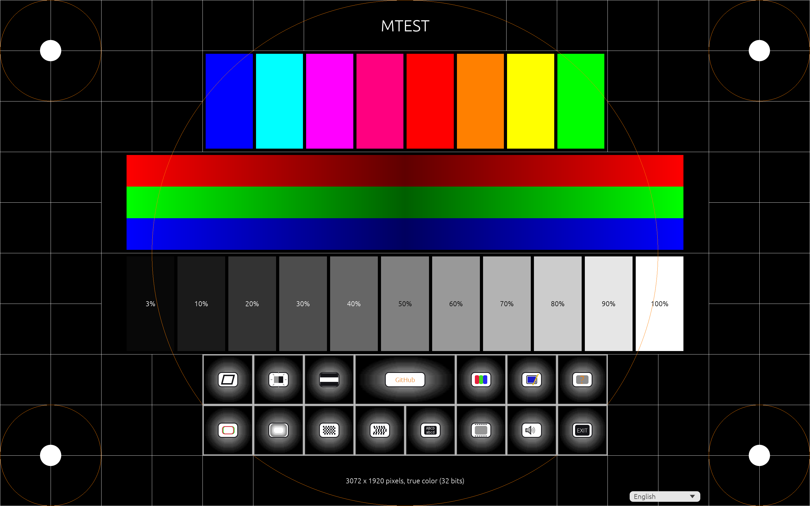

# MTEST

Version v.20261109 (versions are date codes, v.YYYYMMDD).

[English](#english) | [ภาษาไทย](#ภาษาไทย)

## English

A monitor test for today's Windows, Linux and macOS, rebuilt from an old 16-bit Windows **Nokia Monitor Test** (NTEST.EXE)
program: geometry, brightness and contrast, high voltage, colours, convergence, focus, resolution,
moiré, readability and jitter patterns, a left-to-right speaker test and a demo mode. Full screen,
in 10 languages (English, Thai, Finnish, German, French, Spanish, Dutch, Swedish, Norwegian, Italian).

The main screen is itself a test card: grid and circles for geometry, eight colour bars, red, green
and blue ramps, grey steps from 3 % to 100 %, and the buttons for each test.

## Use

- Main screen: click a button (Tab and Enter work too). F1 for help, Alt+F4 or EXIT to quit.
- In a test: click or Page Down for the next pattern (after the last one you return), right click or
  Page Up for the previous one, both mouse buttons or Esc to go back.
- The loudspeaker button plays a tone that moves from the left speaker to the right one; the mouse
  pointer shows a loudspeaker following it.
- Ctrl+Alt+D starts the demo (Esc stops it). Ctrl+Alt+1 to 9 narrows the window to 10-90 % of the
  screen width, Ctrl+Alt+0 makes it full screen again.

## Download and build

Programs for every system are built by GitHub Actions (`.github/workflows/build.yml`): see the
Actions run's artifacts, or the release for a version tag. To build yourself, see `BUILDING.md`.
How each pattern is drawn, with the original program's code addresses, is in `MECHANICS.md`.

## ภาษาไทย

รุ่น v.20261109 (ใช้วันที่เป็นเลขรุ่นในรูปแบบ v.YYYYMMDD)

MTEST คือโปรแกรมทดสอบจอภาพสำหรับ Windows, Linux และ macOS ในปัจจุบัน พัฒนาขึ้นใหม่จาก
**Nokia Monitor Test** (NTEST.EXE) โปรแกรมบน Windows แบบ 16 บิต รองรับการทดสอบรูปทรงและสัดส่วนภาพ
ความสว่างและคอนทราสต์ แรงดันสูง สี การซ้อนทับของแม่สี ความคมชัด ความละเอียด ลายมัวเร
ความชัดเจนของตัวอักษร และการสั่นของภาพ พร้อมทดสอบเสียงจากลำโพงซ้ายไปขวาและโหมดสาธิต
แสดงผลเต็มหน้าจอ และรองรับ 10 ภาษา ได้แก่ อังกฤษ ไทย ฟินแลนด์ เยอรมัน ฝรั่งเศส สเปน
ดัตช์ สวีเดน นอร์เวย์ และอิตาลี

หน้าจอหลักเป็นภาพทดสอบในตัว ประกอบด้วยเส้นตารางและวงกลมสำหรับตรวจสอบรูปทรงภาพ แถบสี 8 สี
แถบไล่ระดับสีแดง เขียว และน้ำเงิน ระดับสีเทาตั้งแต่ 3% ถึง 100% และปุ่มเลือกการทดสอบแต่ละแบบ
เลือกภาษาไทยได้จากรายการภาษาที่มุมขวาล่าง

### วิธีใช้งาน

- หน้าจอหลัก: คลิกปุ่มเพื่อเลือกการทดสอบ หรือใช้ Tab และ Enter กด F1 เพื่อดูวิธีใช้
  และกด Alt+F4 หรือปุ่ม EXIT เพื่อออกจากโปรแกรม
- ระหว่างทดสอบ: คลิกเมาส์หรือกด Page Down เพื่อดูภาพถัดไป เมื่อครบแล้วจะกลับหน้าจอหลัก
  คลิกขวาหรือกด Page Up เพื่อดูภาพก่อนหน้า คลิกเมาส์ทั้งสองปุ่มพร้อมกันหรือกด Esc เพื่อกลับหน้าจอหลัก
- ปุ่มลำโพง: เล่นเสียงเคลื่อนจากลำโพงซ้ายไปขวา โดยตัวชี้เมาส์จะแสดงรูปลำโพงเคลื่อนตามเสียง
- กด Ctrl+Alt+D เพื่อเริ่มโหมดสาธิต และกด Esc เพื่อหยุด
- กด Ctrl+Alt+1 ถึง 9 เพื่อปรับความกว้างหน้าต่างเป็น 10–90% ของความกว้างหน้าจอ
  และกด Ctrl+Alt+0 เพื่อกลับไปแสดงผลเต็มหน้าจอ

### ดาวน์โหลดและ build

GitHub Actions (`.github/workflows/build.yml`) จะ build โปรแกรมสำหรับแต่ละระบบ
ดาวน์โหลดได้จาก artifacts ของการรันในหน้า Actions หรือหน้า Release ของแท็กรุ่นนั้น
หากต้องการ build ด้วยตนเอง ดู [BUILDING.md](BUILDING.md)
ส่วนรายละเอียดการวาดภาพทดสอบแต่ละแบบ พร้อมตำแหน่งโค้ดในโปรแกรมต้นฉบับ อยู่ใน [MECHANICS.md](MECHANICS.md)
